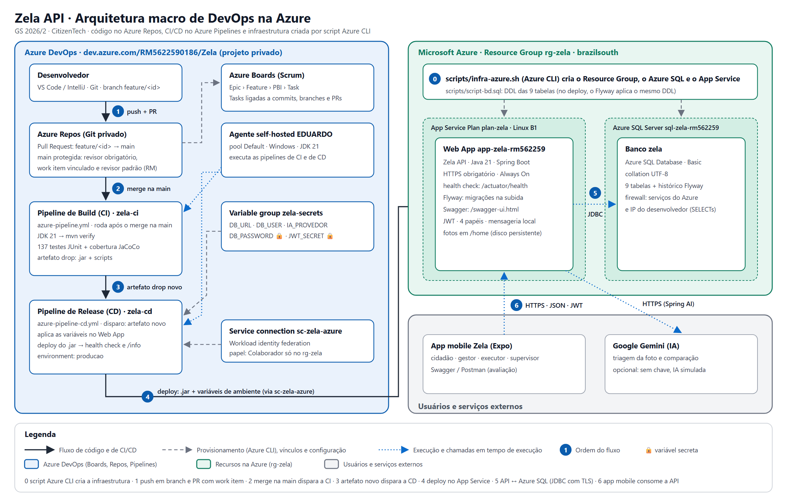

# Zela API — zeladoria colaborativa com IA

> Global Solution 2026/2 · **CitizenTech** · FIAP · 2º ano ADS · disciplina **Java Advanced**
> Repositório: https://github.com/Tidlle/GS2-Java · Deploy (Azure): https://app-zela-rm562259.azurewebsites.net/swagger-ui.html · Vídeo pitch: https://www.youtube.com/watch?v=3adCKNu-mI8

| RM | Nome | Turma |
|---|---|---|
| 562707 | João Victor Alcantara | 2TDSR |
| 565399 | Phillipo Barbosa | 2TDSA |
| 562259 | Eduardo Martins | 2TDSR |
| 562944 | Leonardo Aragaki Rodrigues | 2TDSR |

Buracos, postes apagados, entulho e calçadas quebradas ficam meses sem solução: o cidadão não sabe a quem recorrer, a mesma ocorrência é aberta várias vezes e a prefeitura não consegue fiscalizar quem executa o serviço.

O **Zela** transforma uma foto tirada pelo cidadão em uma **ordem de serviço rastreável de ponta a ponta**: a IA classifica o problema, os vizinhos confirmam, a OS vai para o executor responsável, que faz check-in no local e conclui com foto. A IA compara o antes e o depois, e o cidadão confirma ou contesta.

Esta é a **API principal**, consumida pelo app mobile (Expo/React Native) e publicada na Azure pela disciplina de DevOps.

**ODS:** 11 (cidades sustentáveis) · 10 (redução das desigualdades) · 9 (infraestrutura).

---

## Stack

| Item | Tecnologia |
|---|---|
| Linguagem | Java 21 |
| Framework | Spring Boot 4.1 (Web MVC, Data JPA, Validation, Security, Actuator, AMQP) |
| Autenticação | Spring Security + JWT |
| IA generativa | Spring AI 2.0 + **Google Gemini** |
| Mensageria (requisito 5, opção A) | **RabbitMQ** |
| Banco | H2 (desenvolvimento e testes) · **Azure SQL Database** (produção) · migrações com Flyway |
| Nuvem e DevOps | Azure App Service · Azure SQL · Azure Boards, Repos e Pipelines · Azure CLI ([seção DevOps](#devops-e-nuvem-azure)) |
| Documentação | springdoc-openapi (Swagger UI) |
| Build | Maven Wrapper · Docker |

---

## Como rodar

### Opção 1 — Docker Compose (API + RabbitMQ)

Requisito: Docker.

```bash
docker compose up --build
```

### Opção 2 — Maven

Requisito: JDK 21. Os eventos vão para o RabbitMQ, então suba só ele antes:

```bash
docker compose up -d rabbitmq
./mvnw spring-boot:run
```

Sem Docker, rode com a mensageria local (os eventos são processados no mesmo processo, sem broker): crie um `.env` com `MENSAGERIA_MODO=local`.

No Windows (PowerShell ou cmd), use `mvnw.cmd spring-boot:run`.

### Endereços

| O quê | URL |
|---|---|
| Swagger UI | http://localhost:8080/swagger-ui.html |
| OpenAPI (JSON) | http://localhost:8080/v3/api-docs |
| Informações da API | http://localhost:8080/info |
| Health check | http://localhost:8080/actuator/health (banco e disco; o RabbitMQ fica de fora porque a API funciona sem ele) |
| Console do H2 (dev) | http://localhost:8080/h2-console · JDBC URL `jdbc:h2:mem:zela` · usuário `sa`, sem senha |
| Painel do RabbitMQ | http://localhost:15672 · `guest` / `guest` |

### Testes

```bash
./mvnw verify
```

Os testes usam o perfil `test` e rodam **sem RabbitMQ e sem chave de IA**, como o pipeline de CI exige.

- **137 testes** (unidade e integração com MockMvc): regras de domínio, segurança por papel e por posse, validações, CRUDs, fluxo completo da OS, IA, mensageria, prazos e indicadores.
- Relatórios JUnit: `target/surefire-reports`. Cobertura (JaCoCo, **93% das linhas**): `target/site/jacoco/index.html` (e `jacoco.xml` para o CI).

### Postman

`postman/zela-api.postman_collection.json` tem 58 requisições em 6 pastas. Rode primeiro a pasta **1. Autenticação**: ela guarda o token de cada papel e as demais já usam o certo. Os ids criados (categoria, executor, ocorrência) também ficam em variáveis. A coleção é gerada por `docs/ferramentas/gerar_postman.py`.

---

## Configuração

Perfis: `dev` (padrão: H2 em memória, IA simulada), `test` (testes automatizados) e `prod` (nuvem: tudo por variável de ambiente).

Copie `.env.example` para `.env` para definir variáveis locais. O `.env` não vai para o Git.

| Variável | Uso | Obrigatória em prod |
|---|---|---|
| `SPRING_PROFILES_ACTIVE` | Perfil ativo (`dev`, `prod`) | sim |
| `DB_URL`, `DB_USER`, `DB_PASSWORD` | Conexão com o banco | sim |
| `JWT_SECRET` | Segredo do JWT (mínimo 32 caracteres) | sim |
| `JWT_EXPIRACAO_HORAS` | Validade do token (padrão 8) | não |
| `CORS_ORIGENS` | Origens liberadas para o navegador, separadas por vírgula (padrão `*`) | não |
| `RABBITMQ_HOST`, `RABBITMQ_PORT`, `RABBITMQ_USER`, `RABBITMQ_PASSWORD` | Conexão com o RabbitMQ | sim |
| `IA_PROVEDOR` | `none` (IA simulada) ou `google-genai` (Gemini) | não |
| `GEMINI_API_KEY` | Chave da API do Gemini | se `IA_PROVEDOR=google-genai` |
| `IA_MODELO` | Modelo do Gemini (padrão `gemini-3.5-flash-lite`) | não |
| `FOTOS_DIRETORIO` | Pasta das fotos enviadas (padrão `uploads`) | não |
| `MENSAGERIA_MODO` | `rabbitmq` (padrão) ou `local` (sem broker) | não |
| `AGENDAMENTO_HABILITADO` | Liga o agendador de prazos (padrão `true`) | não |
| `AGENDAMENTO_INTERVALO` | Intervalo do agendador em ISO-8601 (padrão `PT5M`) | não |
| `ZELA_AMBIENTE` | Nome do ambiente exibido em `/info` | não |

Nenhuma senha ou chave fica no código: os valores de produção vêm das variáveis do pipeline.

---

## Estrutura

```
├── azure-pipeline.yml        # pipeline de Build (CI) no Azure Pipelines
├── azure-pipeline-cd.yml     # pipeline de Release (CD): deploy no Azure App Service
├── docker-compose.yml        # API + RabbitMQ para rodar localmente
├── dockerfiles/Dockerfile    # imagem da API (build multi-stage)
├── scripts/                  # script-bd.sql e scripts Azure CLI (DevOps)
├── docs/                     # planos e desenho da arquitetura (arquitetura-devops.png)
└── src/main/java/br/com/zela/api/
    ├── config/        # OpenAPI, propriedades, CORS, RabbitMQ
    ├── seguranca/     # JWT e regras de acesso por papel
    ├── dominio/       # entidades JPA, enums e máquina de estados
    ├── repositorio/   # Spring Data JPA
    ├── servico/       # regras de negócio
    ├── ia/            # Spring AI (Gemini) e IA simulada
    ├── mensageria/    # eventos e consumidores do RabbitMQ
    ├── armazenamento/ # fotos
    ├── agendamento/   # prazos, escalonamento e aceite tácito
    ├── web/           # controllers e DTOs
    └── excecao/       # tratamento global de erros
```

---

## Usuários de teste

Criados pela carga inicial (Flyway `V2`). Senha de todos: **`123456`**.

| Papel | E-mail | Observação |
|---|---|---|
| Cidadão | `cidadao@zela.com` | Ana Souza, Vila Mariana |
| Cidadão | `cidadao2@zela.com` | João Pereira, autor de ocorrências aguardando confirmação |
| Gestor | `gestor@zela.com` | Carlos Lima, Subprefeitura Vila Mariana |
| Executor | `executor@zela.com` | Equipe Luz Norte (iluminação) |
| Supervisor | `supervisor@zela.com` | Marina Costa |
| Executor | `pavimentacao@zela.com` · `limpeza@zela.com` · `calcadas@zela.com` · `plantao@zela.com` | Um usuário para cada executor |

A carga traz os mesmos cenários do app: 13 ocorrências e 9 ordens de serviço cobrindo os status do ciclo (emitida, aceita, em execução, concluída, reaberta, escalada, encaminhada e encerrada), com a timeline de cada OS.

---

## Modelo de dados

```
Executor 1──N Categoria          (executor responsável pelo contrato da categoria)
Executor 1──N Usuario            (usuários do papel EXECUTOR)
Usuario  1──N Ocorrencia         (autor)
Categoria 1──N Ocorrencia
Ocorrencia 1──N Confirmacao N──1 Usuario   (um voto por usuário)
Ocorrencia 1──N OrdemServico N──1 Executor (ocorrencia.ordemAtual aponta a OS vigente)
OrdemServico 1──N EventoOS       (timeline e auditoria)
OrdemServico 1──N Avaliacao N──1 Usuario
Usuario 1──N Notificacao
```

- **Máquina de estados:** os enums `StatusOcorrencia` e `StatusOS` definem as transições permitidas. Toda mudança passa por `transicionar(...)`, que recusa transições inválidas e grava o evento na timeline (auditoria: quem, quando, de qual para qual status e por quê).
- **Localização** (`@Embedded`): latitude e longitude, com distância calculada pela fórmula de Haversine (usada no check-in da OS).
- **Schema:** criado pelo Flyway (`src/main/resources/db/migration/{banco}`); o Hibernate só valida (`ddl-auto: validate`). Datas gravadas em UTC.

---

## Autenticação (JWT)

1. `POST /auth/login` com e-mail e senha. A senha é conferida com o hash **BCrypt** guardado no banco.
2. A API devolve um **JWT** assinado com HMAC-SHA256 (segredo `JWT_SECRET`), válido por 8 horas. Claims: `sub` (id do usuário), `papel`, `nome`, `email`.
3. O app envia `Authorization: Bearer <token>` em todas as chamadas.
4. O **OAuth2 Resource Server** do Spring Security valida assinatura e validade e transforma o claim `papel` em `ROLE_<PAPEL>`.
5. Cada endpoint declara quem pode usá-lo com `@PreAuthorize` (ex.: `hasRole('GESTOR')`). Sem token: **401**; papel sem permissão: **403**.

No Swagger, faça login em `POST /auth/login`, copie o `token` e cole no botão **Authorize**.

Proteções extras: o emissor (`iss`) do token é conferido e, depois de 5 senhas erradas para o mesmo e-mail, o login fica bloqueado por 15 minutos (429).

## Regras do fluxo de ocorrências

| Situação | Como a API resolve |
|---|---|
| Reporte normal | Fica `AGUARDANDO_CONFIRMACAO`; prioridade inicial = risco da categoria |
| Emergência (`urgente: true`) | Pula a confirmação, prioridade máxima e OS imediata ao executor da categoria com prazo de plantão (4 h) |
| Vizinho confirma ("sim") | Prioridade +1 e reputação de quem reportou +1. Com 3 "sim", fica `CONFIRMADA` |
| Confirmada, categoria de rotina | OS emitida automaticamente ao executor do contrato, com o prazo contratual |
| Confirmada, categoria fora da regra | Vai para a fila de exceções do gestor (emitir, encaminhar ou descartar) |
| Vizinhos negam ("não") | Com 3 "não", `DESCARTADA` e reputação do autor −5 |
| Votos | Um por pessoa; quem reportou não vota na própria ocorrência |

## Ciclo da ordem de serviço

| # | Etapa | Quem | Controle |
|---|---|---|---|
| 1 | **Emitida** | sistema ou gestor | Prazo contratual da categoria (plantão: 4 h) |
| 2 | **Aceita** ou **recusada** | executor | Recusa exige motivo; o gestor reatribui ou encaminha a outro órgão com protocolo |
| 3 | **Em execução** | executor | Check-in por GPS a até 100 m do local (senão 422 com a distância) |
| 4 | **Concluída** | executor | Foto do depois obrigatória |
| 5 | **Validada** | gestor ou cidadão | Aprovação encerra e resolve a ocorrência; reprovação ou contestação reabre como **retrabalho** (24 h) |
| 6 | **Encerrada** | sistema | Entra nos indicadores do executor |

Cada passo grava um evento na **timeline** (quem, quando, de qual para qual status e por quê), que é também a trilha de auditoria. O supervisor vê as OS escaladas ou atrasadas, cobra o executor e reatribui.

Os limites ficam em `zela.regras` no `application.yml` (3 confirmações, 3 negações, 4 h de plantão, raio de 2 km).

## Prazos automáticos

Um agendador (`@Scheduled`, a cada 5 minutos) aplica as regras de prazo. Para a demonstração, `POST /prazos/executar` roda o mesmo ciclo na hora.

| Regra | Quando | O que acontece |
|---|---|---|
| Confirmação que não bloqueia | Ocorrência aguardando vizinhos há mais de 24 h | Segue como confirmada; categoria de rotina vira OS automática, as outras vão às exceções |
| Escalonamento | Etapa emitida, aceita, em execução ou reaberta com prazo vencido | OS fica `ESCALADA`; supervisor e cidadão são avisados. Ao retomar, a etapa ganha 24 h de recuperação |
| Aceite tácito | OS concluída há mais de 48 h, IA com confiança ≥ 0,8 e sem resposta do cidadão | Validada e encerrada automaticamente; a ocorrência fica resolvida |

Cada item é tratado na própria transação: se um falhar, os outros seguem. Os limites ficam em `zela.regras` e o intervalo em `AGENDAMENTO_INTERVALO`.

## Indicadores

| Indicador | Como é calculado |
|---|---|
| Prazos cumpridos | OS concluídas antes do prazo da etapa ÷ OS concluídas |
| Retrabalho | OS reprovadas pelo gestor ou contestadas pelo cidadão ao menos uma vez ÷ OS concluídas |
| Tempo médio | Horas da emissão da OS até a conclusão |
| Avaliação | Média das notas (1 a 5) dadas pelos cidadãos |
| Bairros | Ocorrências, resolvidas e horas até a solução, do bairro mais rápido para o mais lento |

Em desenvolvimento, a carga inclui um **histórico de demonstração** (`db/demo`: 18 OS encerradas em quatro bairros) para os indicadores terem dados. Os testes não carregam esse histórico.

## Inteligência artificial (Spring AI + Google Gemini)

A IA faz parte do fluxo, não é um chat solto: a resposta dela **decide o caminho** da ocorrência e da OS.

| Momento | O que a IA faz | Efeito no fluxo |
|---|---|---|
| Reporte (`POST /ocorrencias/triagem`) | Recebe a foto e as categorias cadastradas; devolve categoria, descrição padronizada, urgência e confiança | A categoria define o executor do contrato e o prazo; a urgência manda direto ao plantão e mostra 199/193 ao cidadão |
| Conclusão da OS (`POST /ordens/{id}/concluir`) | Compara a foto do antes com a do depois | Grava `confiancaIA` (0 a 1) e um evento na timeline; alta confiança sem contestação permite o aceite tácito |

**Como funciona:** `ChatClient` do Spring AI com mensagem multimodal (texto + imagem) e **saída estruturada**: o Spring AI acrescenta ao prompt o formato JSON e converte a resposta nos records `Triagem` e `Comparacao`.

**Conferências sobre a resposta da IA:**
- a categoria precisa ser uma das cadastradas (sem diferenciar acento e maiúsculas); se a IA inventar outra, o cidadão escolhe manualmente;
- a confiança é limitada a 0 a 1; abaixo de 0,5 o app avisa para conferir;
- se a IA falhar (sem rede, cota, chave inválida), o reporte continua: a foto fica salva e a decisão passa a ser humana. O motivo vai para o log.

**Ativar o Gemini:** crie um arquivo `.env` na raiz (já está no `.gitignore`) com:

```
IA_PROVEDOR=google-genai
GEMINI_API_KEY=sua-chave
```

A chave é gratuita em https://aistudio.google.com/apikey (veja "Como obter a chave" abaixo). O modelo padrão é o `gemini-3.5-flash-lite`: o `gemini-2.5-flash` foi descontinuado pelo Google e contas novas não conseguem usá-lo.

Sem isso, a API usa a **IA simulada** (determinística e sem rede), que é a usada nos testes e no CI. Em `POST /ocorrencias/triagem` a resposta traz `origem: "gemini"` ou `"simulada"`.

**Como obter a chave:** entre em https://aistudio.google.com/apikey com uma conta Google, aceite os termos e clique em **Create API key** (contas novas já ganham um projeto e uma chave padrão). Copie a chave para o `.env`; ela nunca vai para o Git. Na camada gratuita o Google pode usar o conteúdo enviado para melhorar os produtos dele, então teste com fotos de ruas sem pessoas.

**Significado da confiança:** `confiancaIA` é a certeza de que o problema **foi resolvido**. Se a IA diz que não foi resolvido, a confiança gravada é **0**, qualquer que seja o número devolvido pelo modelo: assim uma OS não resolvida nunca atinge os 80% do aceite tácito.

### Resultados com fotos reais (Gemini `gemini-3.5-flash-lite`, 12/11/2026)

Triagem (`POST /ocorrencias/triagem`) com uma foto de cada categoria:

| Foto | Categoria sugerida | Confiança | Urgente | Tempo |
|---|---|---|---|---|
| Buraco no asfalto | Buraco | 98% | não | 3,3 s |
| Poste de luz com fiação | Iluminação | 90% | não | 1,6 s |
| Sacos de lixo na calçada | Entulho | 95% | não | 2,6 s |
| Calçada danificada por raízes | Calçada | 95% | não | 2,2 s |
| Árvore caída ao lado de uma estrada | Árvore | 95% | **sim** (aviso 199/193) | 2,4 s |

As 5 categorias vieram corretas. Uma imagem cinza sem problema nenhum foi recusada ("não reconheceu um problema de zeladoria"), e o cidadão escolhe a categoria. Comparação antes/depois na conclusão da OS (cerca de 2 s):

| Caso | Resultado da IA | `confiancaIA` |
|---|---|---|
| Mesma foto no antes e no depois | "Não resolvido: as imagens são idênticas" | 0 |
| Depois = foto de outro local | "Não resolvido: locais completamente diferentes" | 0 |

**O que os testes revelaram:** na primeira rodada, o Gemini respondeu "não resolvido, com 100% de confiança" para as fotos idênticas, e a API gravou 100%, o que permitiria o aceite tácito de uma OS não resolvida. A correção é a regra acima (confiança 0 quando não resolvido) e um pedido mais claro à IA, ambos com testes automatizados.

**Ainda não testado com foto real:** o caso "resolvido" (antes e depois do mesmo local, com o reparo feito). A urgência pode ser sensível: a árvore caída ao lado de uma estrada de terra foi marcada como urgente.

Fotos usadas (Wikimedia Commons, licenças livres; a autoria está em cada página): [buraco](https://commons.wikimedia.org/wiki/File:Potholes_on_asphalt_road_20171023.jpg) (CC BY-SA 4.0), [poste](https://commons.wikimedia.org/wiki/File:Telegraph_pole-mounted_streetlight_on_Quex_View_Road_-_geograph.org.uk_-_1485279.jpg) (CC BY-SA 2.0), [lixo](https://commons.wikimedia.org/wiki/File:Everyday_Dumping_(36312775123).jpg) (CC BY-SA 2.0), [calçada](https://commons.wikimedia.org/wiki/File:Damaged_sidewalk_in_Poland,_besch%C3%A4digte_Gehweg_Pflastersteine.jpg) (CC BY 3.0) e [árvore](https://commons.wikimedia.org/wiki/File:Road_blocked_by_fallen_tree_-_geograph.org.uk_-_2927837.jpg) (CC BY-SA 2.0).

**Limitações:** a IA vê só a foto (não confirma o local; isso é papel do GPS no check-in); fotos escuras ou de outro ângulo reduzem a confiança; a decisão final pode sempre ser revista pelo gestor ou contestada pelo cidadão.

**Fotos:** o tipo é conferido pelos bytes do arquivo (não pela extensão), o nome é gerado pelo servidor e a leitura só aceita esse formato de nome, o que impede acessar outros arquivos do servidor.

## Mensageria (requisito 5 — opção A: RabbitMQ)

Cada mudança de status de uma OS ou de uma ocorrência vira um **evento** publicado no RabbitMQ e consumido de forma **assíncrona**.

```
 API (transação)                       RabbitMQ                                   Consumidores
 ───────────────                       ────────                                   ────────────
 OS/ocorrência muda de status          exchange zela.eventos (topic)
   └─ entidade registra o evento ──►   ├─ "os.*", "ocorrencia.*"  ─► zela.notificacoes ─► cria avisos no app
      (publicado só após o COMMIT)     └─ "os.escalada",          ─► zela.alertas      ─► alerta de urgência
                                          "ocorrencia.urgente"                            e escalonamento
                                       falhou 3x ─► zela.eventos.dlx ─► zela.*.dlq
```

1. A entidade (`OrdemServico`, `Ocorrencia`) registra um **evento de domínio** a cada `transicionar(...)`.
2. Um listener JPA publica o evento no Spring quando a entidade é gravada.
3. `PublicadorDeEventos` (`@TransactionalEventListener(AFTER_COMMIT)`) envia ao exchange `zela.eventos` com a chave de roteamento do evento (ex.: `os.escalada`). Se a operação der erro e for desfeita, **nada é publicado**.
4. `ConsumidoresRabbit` (`@RabbitListener`) recebe as mensagens JSON. A fila de notificações cria os avisos (`GET /notificacoes`); a de alertas registra urgências e escalonamentos.
5. Mensagem que falha 3 vezes vai para a fila `.dlq` (não se perde e não trava a fila).

| Evento | Quem é avisado |
|---|---|
| `os.emitida` | Cidadão ("Sua ocorrência virou OS") e equipe executora ("Nova OS") |
| `os.recusada` | Gestores |
| `os.em_execucao` · `os.concluida` | Cidadão ("A equipe chegou" · "Confirme a solução") |
| `os.reaberta` | Equipe executora (retrabalho) |
| `os.escalada` | Supervisores e cidadão |
| `os.encerrada` | Cidadão ("Sua ocorrência foi resolvida") |
| `ocorrencia.urgente` | Supervisores e gestores |
| `ocorrencia.confirmada` · `descartada` · `encaminhada` | Cidadão |

**Ver funcionando:** com `docker compose up`, abra o painel em http://localhost:15672 (`guest`/`guest`), aba *Exchanges* → `zela.eventos` e aba *Queues* → `zela.notificacoes`. Faça uma ação no Swagger (ex.: reportar algo urgente) e veja a mensagem passar e o aviso aparecer em `GET /notificacoes`.

**Testado com o broker real** (RabbitMQ 4.1 no Docker, 18/11/2026):

| Teste | Resultado |
|---|---|
| Ocorrência urgente reportada | 1 mensagem em `zela.alertas` e 2 em `zela.notificacoes`, todas confirmadas (ack), DLQs vazias |
| Mensagem inválida no exchange | 3 tentativas com espera crescente (1 s, 2 s) e depois vai para `zela.notificacoes.dlq`, sem travar a fila |
| Broker parado | A API segue no ar e a ocorrência é gravada (201); o evento daquele momento não é publicado depois (não há tabela de eventos pendentes) |
| Broker religado | Os consumidores reconectam sozinhos e os novos eventos voltam a ser processados |

O `docker-compose.yml` força `MENSAGERIA_MODO=rabbitmq` no container, mesmo que o `.env` tenha `local`. Na nuvem (Azure) a API roda com `MENSAGERIA_MODO=local`: não há broker lá.

**Modo local** (`MENSAGERIA_MODO=local`): mesmos eventos e mesmas regras, processados no mesmo processo. Usado nos testes automatizados (o CI roda sem broker) e para rodar sem Docker.

## Erros

Todas as respostas de erro seguem o padrão **ProblemDetail** (RFC 9457), via `@RestControllerAdvice`:

```json
{
  "type": "https://zela.app/erros/validacao",
  "title": "Dados inválidos",
  "status": 400,
  "detail": "Um ou mais campos estão inválidos",
  "instance": "/categorias",
  "timestamp": "2026-11-09T23:26:19Z",
  "erros": [ { "campo": "riscoBase", "mensagem": "O risco base vai de 1 a 5" } ]
}
```

| Status | Quando |
|---|---|
| 400 | Bean Validation nos DTOs, JSON malformado, parâmetro com tipo errado |
| 401 | Sem token, token inválido, expirado ou de outro emissor, login recusado |
| 403 | Papel sem permissão |
| 404 | Recurso inexistente |
| 409 | Conflito: e-mail ou nome repetido, exclusão de registro em uso, transição de status inválida |
| 422 | Regra de negócio (ex.: check-in longe do local) |
| 429 | Login bloqueado por 15 minutos após 5 senhas erradas |
| 500 | Erro inesperado (sem detalhes internos; stack trace só no log) |

## Endpoints

Listagens são paginadas: `?page=0&size=20&sort=nome,asc`. Resposta: `{ "content": [...], "page": { "size", "number", "totalElements", "totalPages" } }`.

| Método | Rota | Acesso | Descrição |
|---|---|---|---|
| POST | `/auth/login` | público | Login; devolve o JWT e os dados do usuário |
| POST | `/auth/cadastro` | público | Cadastro de cidadão |
| GET | `/usuarios/me` | logado | Usuário dono do token |
| GET | `/categorias` · `/categorias/{id}` | logado | Lista (paginada) e detalhe das categorias |
| POST · PUT · DELETE | `/categorias` · `/categorias/{id}` | gestor | CRUD de categorias |
| GET | `/executores` · `/executores/{id}` | gestor, supervisor | Lista (paginada, filtro `nome`) e detalhe |
| POST · PUT · DELETE | `/executores` · `/executores/{id}` | gestor | CRUD de executores |
| POST | `/fotos` | cidadão, executor | Envia uma foto (multipart `arquivo`: JPEG, PNG ou WEBP até 8 MB); devolve a URL |
| GET | `/fotos/{nome}` | público | Baixa a foto (nome aleatório de 32 caracteres) |
| POST | `/ocorrencias/triagem` | cidadão | **IA**: envia a foto e recebe categoria, descrição e alerta de urgência sugeridos |
| POST | `/ocorrencias` | cidadão | Reporta um problema (urgente: OS imediata ao plantão) |
| GET | `/ocorrencias?lat&lng&raio&status` | logado | Lista; com posição, só as do raio e da mais próxima para a mais distante (`distanciaM`) |
| GET | `/ocorrencias/{id}` | logado | Detalhe |
| GET | `/ocorrencias/minhas` | cidadão | Reportadas por mim |
| PUT · DELETE | `/ocorrencias/{id}` | cidadão (autor) | Edita ou exclui a própria ocorrência antes de virar OS |
| GET | `/ocorrencias/para-confirmar` | cidadão | Ocorrências de vizinhos aguardando confirmação |
| POST | `/ocorrencias/{id}/confirmacoes` | cidadão | "Ainda está aqui?" sim/não |
| GET | `/ocorrencias/excecoes` | gestor | Fila de exceções (confirmadas sem emissão automática) |
| GET | `/categorias/{id}/executor-sugerido` | gestor, supervisor | Executor do contrato da categoria |
| POST | `/ocorrencias/{id}/emitir-os` | gestor | Emite a OS (executor e prazo opcionais) |
| POST | `/ocorrencias/{id}/encaminhar` | gestor | Encaminha a outro órgão com protocolo |
| POST | `/ocorrencias/{id}/descartar` | gestor | Descarta com justificativa |
| GET | `/ordens?status&executorId&bairro&atrasadas` | gestor, supervisor | Painel de OS (paginado, filtros combináveis) |
| GET | `/ordens/minhas` | executor | OS da minha equipe |
| GET | `/ordens/{id}` | todos (com posse) | Detalhe com timeline; executor só da equipe, cidadão só das próprias ocorrências |
| GET | `/ordens/escalonadas` | supervisor, gestor | Escaladas ou com prazo vencido |
| POST | `/ordens/{id}/aceitar` · `/recusar` | executor | Aceita ou recusa (motivo obrigatório) |
| POST | `/ordens/{id}/checkin` | executor | Check-in por GPS (até 100 m do local) |
| POST | `/ordens/{id}/concluir` | executor | Conclui com a foto do depois |
| POST | `/ordens/{id}/aprovar` · `/reprovar` | gestor | Aprova (encerra) ou reprova (retrabalho) |
| PATCH | `/ordens/{id}/prazo` | gestor | Novo prazo da etapa |
| POST | `/ordens/{id}/cancelar` · `/encaminhar` | gestor | Cancela (ocorrência volta às exceções) ou encaminha a outro órgão |
| POST | `/ordens/{id}/avaliacao` | cidadão (autor) | Confirma ou contesta a solução, com nota opcional |
| POST | `/ordens/{id}/cobrar` | supervisor | Registra a cobrança na timeline |
| POST | `/ordens/{id}/reatribuir` | supervisor, gestor | Troca o executor (novo prazo) |
| GET | `/notificacoes` | logado | Meus avisos (paginado, mais recentes primeiro) |
| GET | `/notificacoes/nao-lidas` | logado | Quantidade de avisos não lidos |
| POST | `/notificacoes/lidas` | logado | Marca todos como lidos |
| GET | `/indicadores` | gestor, supervisor | Painel: abertas, atrasadas, prazos cumpridos, retrabalho, exceções, bairros |
| GET | `/indicadores/executores` | gestor, supervisor | Desempenho por executor (base para fiscalizar contratos) |
| GET | `/indicadores/bairros` | gestor, supervisor | Tempo de resolução por bairro |
| POST | `/prazos/executar` | supervisor, gestor | Roda agora a verificação de prazos (a mesma do agendador) |
| GET | `/info` | público | Nome, versão e ambiente da API |
| GET | `/actuator/health` | público | Health check |


---

## DevOps e nuvem (Azure)

> Disciplina **DevOps Tools & Cloud Computing**. A solução publicada na nuvem é esta API Java.
> Azure DevOps (projeto privado): https://dev.azure.com/RM5622590186/Zela · API: https://app-zela-rm562259.azurewebsites.net · Swagger: https://app-zela-rm562259.azurewebsites.net/swagger-ui.html

### Solução e conceito

O Zela é uma plataforma de **zeladoria urbana colaborativa**. O cidadão fotografa o problema (buraco, poste apagado, entulho…), a IA faz a triagem, os vizinhos confirmam e a prefeitura acompanha a **ordem de serviço** até o executor concluir com foto. A API Java é o centro da solução: o app mobile e o Swagger a consomem, e ela guarda tudo no Azure SQL.

Na nuvem, o ciclo de entrega é automático: cada mudança entra por **Pull Request** vinculado a uma tarefa do **Azure Boards**; o merge na `main` dispara a **CI** (build e testes), e o artefato novo dispara a **Release**, que publica a API no **Azure App Service**.

### Arquitetura macro



Fonte editável: [`docs/arquitetura-devops.svg`](docs/arquitetura-devops.svg) (o PNG é gerado por `docs/ferramentas/exportar-arquitetura.ps1`).

| Passo | O que acontece |
|---|---|
| 0 | `scripts/infra-azure.sh` (Azure CLI) cria o Resource Group, o Azure SQL e o App Service |
| 1 | O desenvolvedor faz commit numa branch `feature/<id>` e abre um PR vinculado à tarefa do Boards |
| 2 | Com o PR aprovado, o merge na `main` dispara a pipeline de **Build** (`zela-ci`) |
| 3 | A CI publica o artefato **drop**, que dispara a pipeline de **Release** (`zela-cd`) |
| 4 | A Release aplica as variáveis de ambiente e publica o `.jar` no App Service |
| 5 | A API acessa o Azure SQL (JDBC com TLS); o Flyway cria e atualiza as tabelas |
| 6 | O app mobile e o Swagger consomem a API por HTTPS com JWT |

### Recursos na Azure (criados pelo script)

| Recurso | Nome | Configuração |
|---|---|---|
| Resource Group | `rg-zela` | Brazil South |
| Azure SQL Server | `sql-zela-rm562259` | TLS 1.2 · firewall: serviços do Azure e IP do desenvolvedor |
| Azure SQL Database | `zela` | Basic · collation `Latin1_General_100_CI_AS_SC_UTF8` (acentos em `VARCHAR`) |
| App Service Plan | `plan-zela` | Linux · B1 |
| Web App | `app-zela-rm562259` | Java 21 · HTTPS obrigatório · Always On · health check `/actuator/health` |

Na nuvem a mensageria roda em modo `local` (eventos processados no próprio processo, depois do commit); o RabbitMQ é usado localmente com o `docker-compose.yml`.

### Scripts (`/scripts`) e Dockerfile (`/dockerfiles`)

| Arquivo | Para quê |
|---|---|
| [`scripts/infra-azure.sh`](scripts/infra-azure.sh) | Cria (ou confere) todos os recursos na Azure. Idempotente; senhas só por variável de ambiente ou digitadas |
| [`scripts/script-bd.sql`](scripts/script-bd.sql) | DDL das 9 tabelas no Azure SQL (o mesmo que o Flyway aplica no deploy) |
| [`scripts/azure-devops-policies.sh`](scripts/azure-devops-policies.sh) | Políticas da branch `main` no Azure Repos |
| [`scripts/delete-infra.sh`](scripts/delete-infra.sh) | Apaga o Resource Group (pede confirmação) |
| [`dockerfiles/Dockerfile`](dockerfiles/Dockerfile) | Imagem da API (build multi-stage), usada no `docker compose` local |

```bash
az login
bash scripts/infra-azure.sh              # pergunta a senha do admin do Azure SQL
bash scripts/azure-devops-policies.sh    # requer: az extension add --name azure-devops
```

### Azure Boards e Repos

- Projeto **privado** com processo **Scrum**: Epic › Feature › PBI › Tasks; cada mudança tem uma Task.
- Commits com `AB#<id>` e PRs com work item vinculado: a Task mostra commits, branches, PRs e builds.
- Branch `main` protegida (todas bloqueantes): **1 revisor** (o autor pode aprovar o próprio PR, como permitido na GS), **work item vinculado obrigatório**, **revisor padrão RM562259** e comentários resolvidos. A `main` só recebe mudanças por PR.

### Azure Pipelines

| Pipeline | Arquivo | Dispara | Etapas |
|---|---|---|---|
| **Build (CI)** `zela-ci` | [`azure-pipeline.yml`](azure-pipeline.yml) | merge na `main` (nunca no PR) | JDK 21 → `mvn verify` → testes JUnit (137) → cobertura JaCoCo → artefato **drop** (`.jar` + `scripts/`) |
| **Release (CD)** `zela-cd` | [`azure-pipeline-cd.yml`](azure-pipeline-cd.yml) | artefato novo da `zela-ci` | baixar o drop → aplicar as variáveis no Web App → deploy do `.jar` no App Service → health check e `/info` (environment `producao`) |

As duas rodam no agente self-hosted `EDUARDO` (pool `Default`). A Release acessa a Azure pela service connection `sc-zela-azure` (workload identity federation, papel de Colaborador só no `rg-zela`).

### Variáveis de ambiente

Nenhuma senha fica no código: a API lê tudo de variáveis de ambiente (`application-prod.yml`).

| Onde | Variáveis |
|---|---|
| CI (`azure-pipeline.yml`) | `MAVEN_OPTS`, `MAVEN_ARGS`, `IA_PROVEDOR`, `MENSAGERIA_MODO`, `versaoJava`, `artefato` (a CI não precisa de segredos: testes com H2) |
| Variable group `zela-secrets` (Release) | `DB_URL`, `DB_USER`, `IA_PROVEDOR`, **`DB_PASSWORD` 🔒**, **`JWT_SECRET` 🔒** |
| Web App (script de infra) | `SPRING_PROFILES_ACTIVE=prod`, `ZELA_AMBIENTE=azure`, `FOTOS_DIRETORIO`, `CORS_ORIGENS`, `MENSAGERIA_MODO=local`, `AGENDAMENTO_INTERVALO` |

### CRUD em JSON (Categoria e Executor)

Base: `https://app-zela-rm562259.azurewebsites.net` (ou o Swagger). As escritas exigem o papel **GESTOR**.

**1. Login (gestor)** — `POST /auth/login`

```json
{ "email": "gestor@zela.com", "senha": "123456" }
```

Resposta `200`: `{ "token": "eyJhbGciOi…", "tipo": "Bearer", "expiraEm": "…", "usuario": { "id": 2, "nome": "Carlos Lima", "papel": "GESTOR" } }`. Nas próximas requisições: cabeçalho `Authorization: Bearer <token>`.

**2. Executor** (tabela `executores`)

| Operação | Requisição | Resposta |
|---|---|---|
| Create | `POST /executores` | `201` |
| Read | `GET /executores/{id}` · `GET /executores` (paginado) | `200` |
| Update | `PUT /executores/{id}` | `200` |
| Delete | `DELETE /executores/{id}` | `204` |

```json
{
  "nome": "Poda Verde Serviços",
  "tipo": "EMPRESA",
  "regiao": "Zona Sul",
  "contrato": "Contrato 045/2026 — Poda de árvores"
}
```

`tipo`: `EQUIPE_PROPRIA`, `EMPRESA` ou `CONCESSIONARIA`. Exemplo de `PUT`:

```json
{
  "nome": "Poda Verde Serviços Ltda.",
  "tipo": "CONCESSIONARIA",
  "regiao": "Saúde",
  "contrato": "Contrato 045/2026 — Poda e remoção"
}
```

**3. Categoria** (tabela `categorias`; usa o id do executor criado acima)

| Operação | Requisição | Resposta |
|---|---|---|
| Create | `POST /categorias` | `201` |
| Read | `GET /categorias/{id}` · `GET /categorias` | `200` |
| Update | `PUT /categorias/{id}` | `200` |
| Delete | `DELETE /categorias/{id}` | `204` |

```json
{
  "nome": "Sinalização",
  "icone": "warning-outline",
  "executorResponsavelId": 100,
  "prazoHoras": 72,
  "emissaoAutomatica": true,
  "riscoBase": 2
}
```

Exemplo de `PUT`:

```json
{
  "nome": "Sinalização viária",
  "icone": "warning-outline",
  "executorResponsavelId": 100,
  "prazoHoras": 96,
  "emissaoAutomatica": false,
  "riscoBase": 3
}
```

Ordem para excluir: primeiro a **categoria**, depois o **executor** (a categoria referencia o executor; excluir um executor em uso devolve `409`).

**4. Conferência direto no banco (SELECT no Azure SQL)**

Portal Azure › banco `zela` › Query editor (login `zelaadmin`), ou SSMS/Azure Data Studio em `sql-zela-rm562259.database.windows.net`:

```sql
SELECT id, nome, tipo, regiao, contrato FROM executores ORDER BY id DESC;
SELECT id, nome, icone, executor_responsavel_id, prazo_horas, emissao_automatica, risco_base
  FROM categorias ORDER BY id DESC;
```

---

## Declaração de uso de IA

| Ferramenta | Para quê |
|---|---|
| Google Gemini | Funcionalidade da solução: triagem da foto e comparação antes/depois (via Spring AI). |
